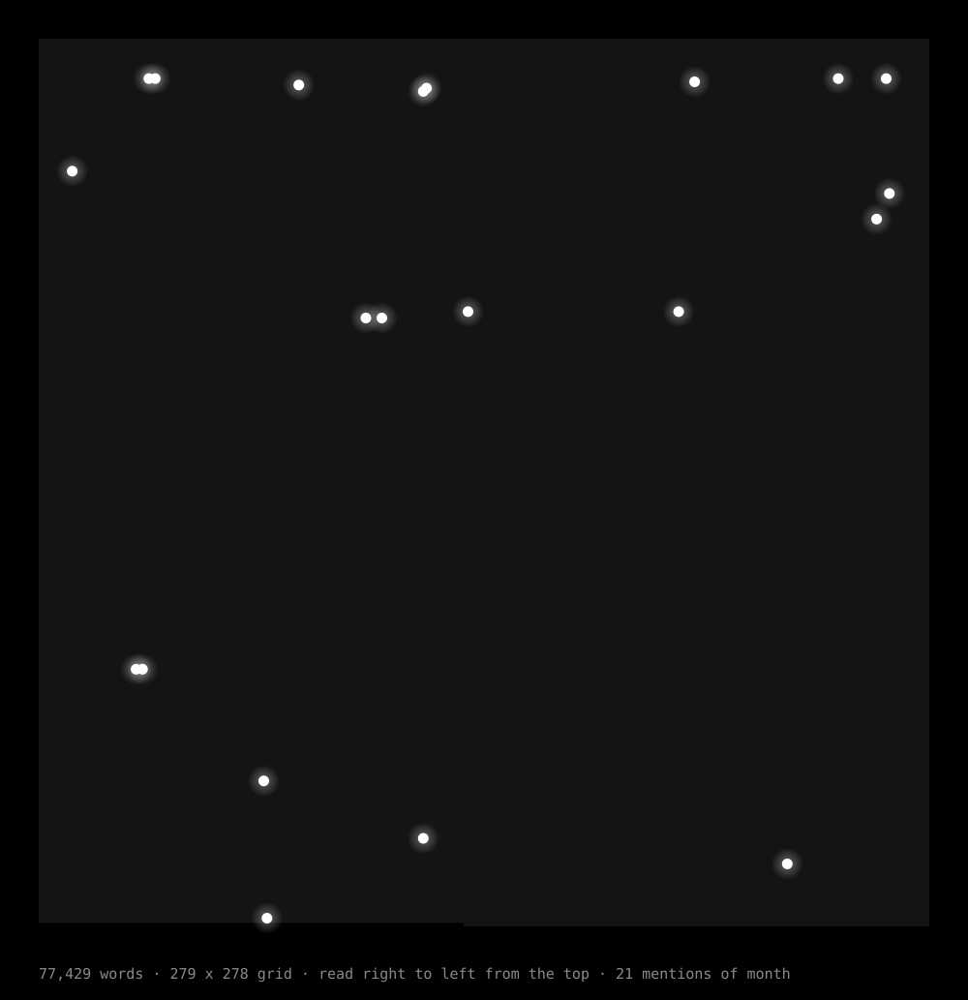

# Every "month" in the Quran

The whole Quran laid out as a square grid on black, with a white dot at every
place the Arabic word for month, **shahr (شهر)**, appears.



Each square is one word. All 77,429 words fill a 279 × 278 grid, read like an
Arabic page: right to left, starting at the top. Open **`index.html`** in a browser
for the interactive version: hover any square to see which verse it is, switch a
square to a verse or a page, filter by word shape, flip the reading direction,
lay the surahs out in revelation order, or connect the dots.

## What the dots show

**21 mentions in 17 verses, across 9 surahs.**

| Shape | Meaning | Count |
|---|---|---|
| شَهْر *shahr* | month | 12 |
| شَهْرَيْن *shahrayn* | two months | 2 |
| أَشْهُر *ashhur* | months | 6 |
| شُهُور *shuhūr* | months | 1 |

- 15 of the 21 sit in the first third of the text: eight in Al-Baqara (2:185 to
  2:234, on fasting, pilgrimage and waiting periods), three in An-Nisa and
  Al-Ma'ida, and four in At-Tawba (9:2, 9:5 and 9:36 twice).
- Then nothing for about 40% of the Quran, from 9:36 to 34:12.
- The last six are scattered through the lower part: 34:12 (twice), 46:15,
  58:4, 65:4 and 97:3, "better than a thousand months", which is 99.4% of the
  way through.
- The singular *shahr* occurs exactly 12 times. 9:36 says "the number of months
  with Allah is twelve months".

| Grid | Squares | Shape |
|---|---|---|
| [Words](docs/month-grid-words.svg) | 77,429 | 279 × 278 |
| [Verses](docs/month-grid-verses.svg) | 6,236 | 79 × 79 |
| [Pages](docs/month-grid-pages.svg) (Madani mushaf) | 604 | 25 × 25 |

The full list, with word positions, is in
[`data/month_occurrences.csv`](data/month_occurrences.csv).

## How it is built

```sh
python3 scripts/build.py
```

Standard library only. The script downloads its sources into `data/raw/`
(ignored by git), then:

1. Splits the Quran into words the way the Quranic Arabic Corpus does
   (77,429 words, 6,236 verses).
2. Marks every word whose root is ش ه ر. In the Quran this root is only used
   for month.
3. Checks that list against a plain spelling search of the Tanzil text for
   ش ه ر, plus ش ه و ر for *shuhūr*. The build stops if the two disagree.
4. Writes `data/month_occurrences.{json,csv}` and `data/quran_structure.json`,
   inlines the data into `index.html`, and redraws the SVGs in `docs/`.

A grid with *n* squares has `ceil(sqrt(n))` columns and as many rows as it
needs, which is the closest to a perfect square. Leftover squares at the end
stay empty.

Some English translations add "month" in brackets in 2:196 and 9:37. The Arabic
word is not in those verses, so they are not counted.

## Sources

- Words and roots: [Quranic Arabic Corpus](https://corpus.quran.com) morphology
  v0.4 (GPL), via
  [mustafa0x/quran-morphology](https://github.com/mustafa0x/quran-morphology).
- Surah list, page breaks, revelation order and the spelling check:
  [Tanzil Project](https://tanzil.net) (CC BY 3.0).
- English: Saheeh International, as published by Tanzil.
